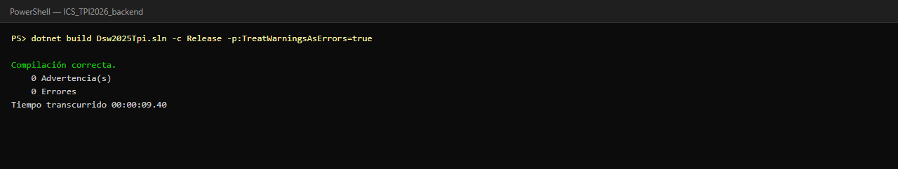
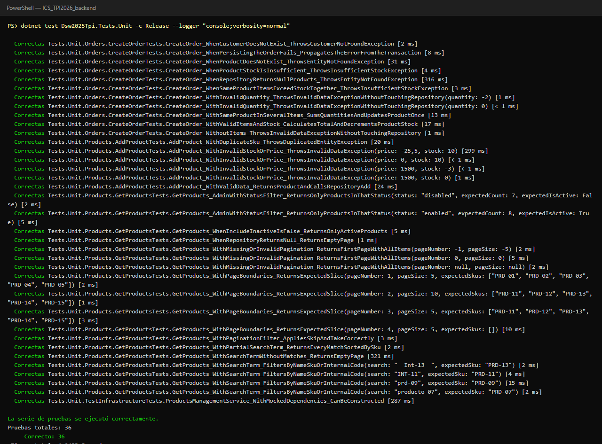
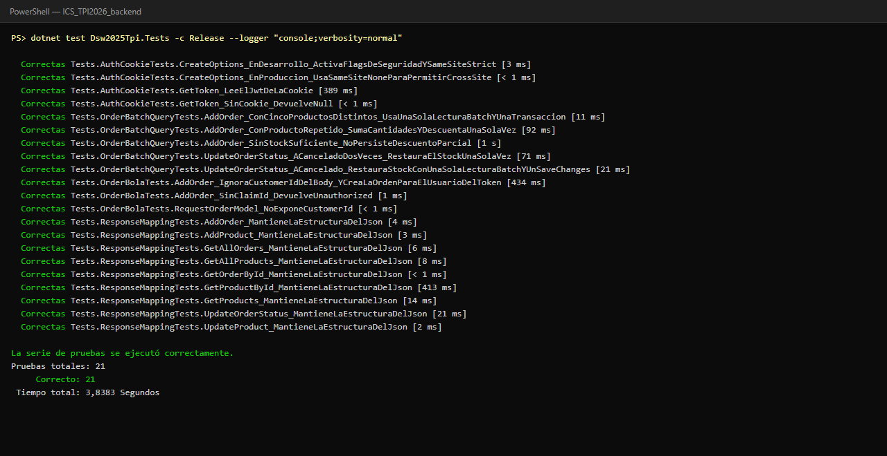
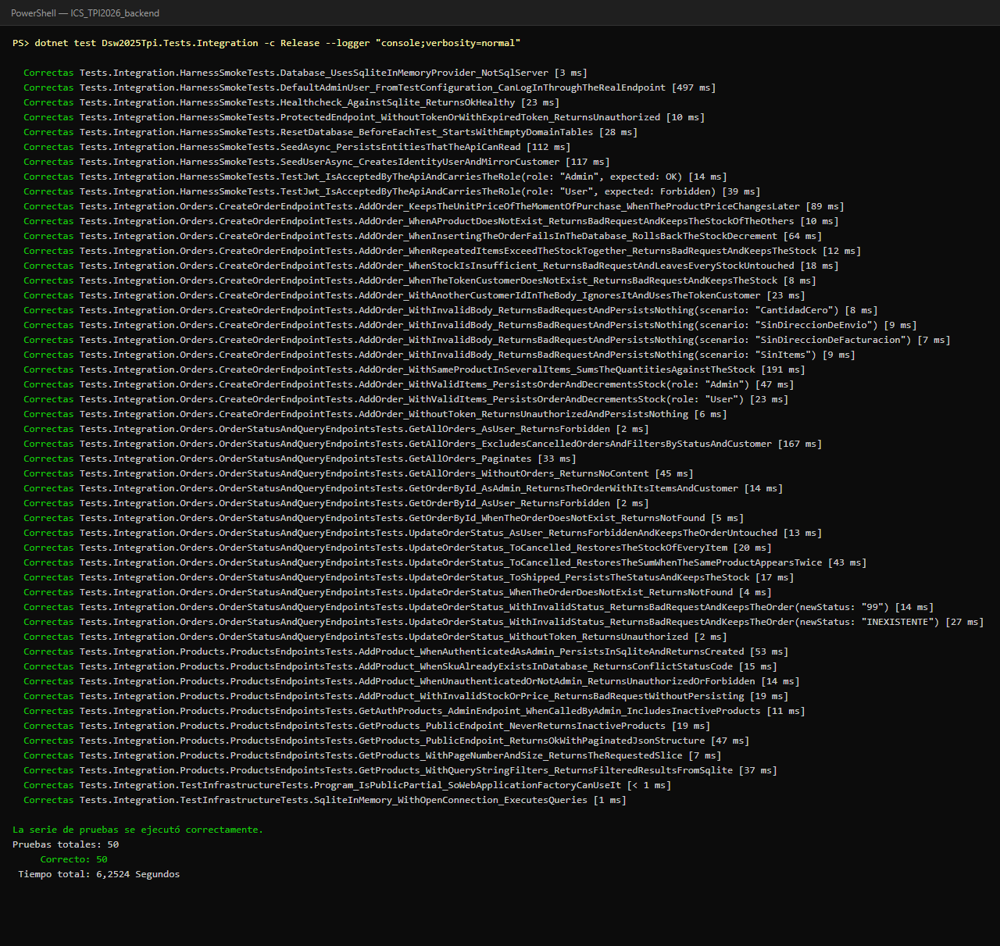
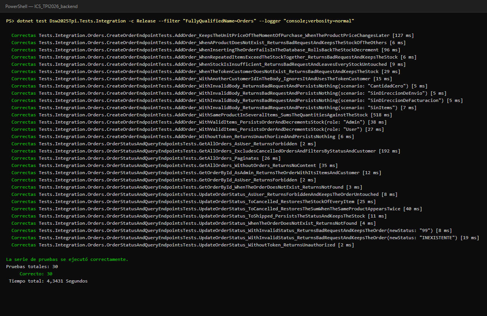
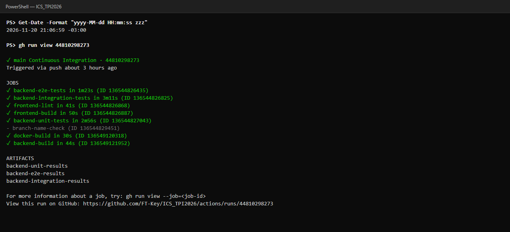
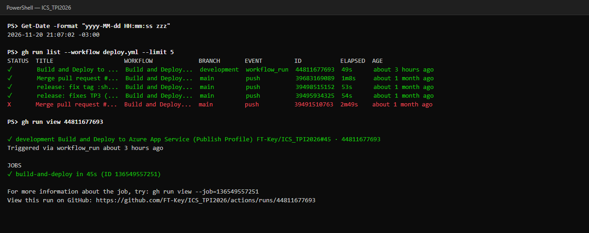
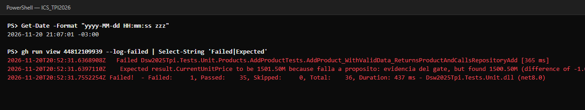
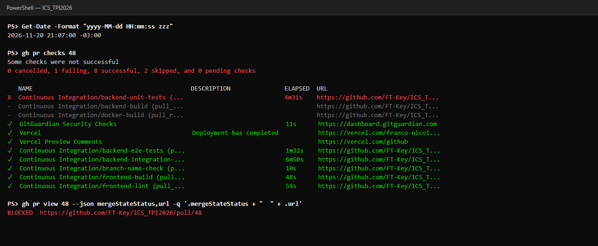

# TP N° 4 — Testing Automatizado: Informe Técnico de Pruebas

**Ingeniería y Calidad del Software — UTN FRT — Comisión 4K2 — Grupo N.º 5 — 2026**

- **Proyecto:** Plataforma E-commerce (API .NET 8 + React + SQL Server) — módulo de Órdenes
- **Repositorio:** https://github.com/FT-Key/ICS_TPI2026
- **Fecha:** 20 de noviembre de 2026
- **Ramas de este documento:** `test/informe-tp4` (borrador, PR #41) y `test/informe-tp4-cierre` (versión final)
- **Versión PDF:** `docs/ICS2026_TP4-Informe.pdf`

> **Estado del documento.** Versión final para revisión del equipo. Las secciones 4 a 7 corresponden a una ejecución real de la suite; la cobertura (7.7) proviene de los artifacts del CI verde sobre `main` (run 44810298273); las evidencias del gate (8.4) son la salida de `gh` sobre el PR #48, abierto a propósito con un test en rojo.

---

## Índice

1. [Introducción y alcance](#1-introducción-y-alcance)
2. [Estrategia de aseguramiento de calidad](#2-estrategia-de-aseguramiento-de-calidad)
3. [Infraestructura de testing](#3-infraestructura-de-testing)
4. [Pruebas unitarias](#4-pruebas-unitarias)
5. [Pruebas de integración](#5-pruebas-de-integración)
6. [Pruebas de regresión](#6-pruebas-de-regresión)
7. [Evidencias de ejecución](#7-evidencias-de-ejecución)
8. [Integración al CI/CD y bloqueo del despliegue](#8-integración-al-cicd-y-bloqueo-del-despliegue)
9. [Pruebas End-to-End (opcional)](#9-pruebas-end-to-end-opcional)
10. [Tablero ágil (Sprint 3)](#10-tablero-ágil-sprint-3)
11. [Hallazgos y defectos encontrados](#11-hallazgos-y-defectos-encontrados)
12. [Conclusiones](#12-conclusiones)
13. [Anexo: comandos y archivos](#13-anexo-comandos-y-archivos)

---

## 1. Introducción y alcance

### 1.1 Objetivo

Construir una suite de pruebas automatizadas siguiendo el modelo de la pirámide de testing (unitarias, integración y, de forma opcional, End-to-End) sobre el backend del e-commerce, de manera que pueda integrarse al pipeline de CI/CD de GitHub Actions del TP3 y actuar como barrera previa al despliegue.

### 1.2 Qué cubre este documento

El enunciado pide describir los casos de prueba diseñados, mostrar capturas de ejecuciones exitosas y demostrar el despliegue bloqueado ante fallos. Este informe se organiza así:

| Requisito del enunciado | Sección |
|---|---|
| Descripción de los casos de prueba diseñados | 4, 5 y 6 |
| Capturas de ejecuciones exitosas | 7 |
| Métricas de cobertura por capa | 7.7 |
| Prueba del despliegue bloqueado ante fallos | 8 |
| Tablero ágil con el tránsito de las tarjetas | 10 |

### 1.3 Alcance funcional probado

El módulo de Órdenes y el catálogo de productos:

- Alta de productos (`POST /api/products`) y listado público y administrativo con búsqueda y paginación.
- Alta de órdenes (`POST /api/orders`) con descuento de stock transaccional.
- Cambio de estado y cancelación de órdenes (`PUT /api/orders/{id}`) con restitución de stock.
- Consulta de órdenes (`GET /api/orders` y `GET /api/orders/{id}`) restringida al rol Admin.

---

## 2. Estrategia de aseguramiento de calidad

### 2.1 Pirámide de testing aplicada

| Capa | Proyecto | Qué verifica | Aislamiento | Cantidad |
|---|---|---|---|---|
| Unitarias | `Dsw2025Tpi.Tests.Unit` | Lógica de negocio de los servicios | Moq sobre `IRepository` y `ILogger`; sin base de datos | 36 |
| Integración | `Dsw2025Tpi.Tests.Integration` | Controladores reales + persistencia + autenticación | `WebApplicationFactory<Program>` y SQLite en memoria | 50 |
| Regresión | `Dsw2025Tpi.Tests` | Contratos y correcciones de sprints anteriores (AT-01, AT-03, AT-05, AT-06) y la corrección de TP4 | SQLite en memoria | 21 |
| End-to-End | `tests/e2e` (Postman/Newman) | Flujo completo de compra contra la API real con SQL Server | API real + SQL Server 2022 | 7 requests / 23 asserts |

Total: **107 pruebas automatizadas, 0 fallos** (sección 7) más el flujo E2E (sección 9).

**Por qué esta forma de pirámide.** La base es ancha porque las reglas de negocio del módulo (cálculo del total, validación de stock, búsqueda y paginación) viven en los servicios de `Dsw2025Tpi.Application`: probarlas con mocks cuesta milisegundos, no depende de infraestructura y señala la regla exacta que se rompió. La capa de integración es la más numerosa en este proyecto por una razón concreta: los riesgos más caros del módulo de Órdenes (autorización por rol, transacción de stock, rollback, contrato JSON y códigos HTTP) solo se observan con el controlador real y una base real, y SQLite en memoria permite ejecutarlos en pocos segundos sin SQL Server. La punta E2E es deliberadamente angosta: un único flujo de compra contra la API desplegada confirma que las piezas encajan (cookie JWT, catálogo, orden y stock) sin duplicar lo que ya cubren las capas inferiores, porque es la capa más lenta y frágil.

### 2.2 Criterios de diseño

- **Una regla de negocio por prueba**, con nombre `Metodo_Escenario_ResultadoEsperado` (por ejemplo `AddOrder_WhenStockIsInsufficient_ReturnsBadRequestAndLeavesEveryStockUntouched`).
- **Estructura Arrange / Act / Assert** en todas las pruebas.
- **Las unitarias no tocan infraestructura:** los mocks son estrictos (`MockBehavior.Strict`) para detectar llamadas inesperadas al repositorio.
- **Las de integración verifican el efecto real en la base:** no alcanza con el código HTTP; se consulta SQLite para comprobar filas insertadas y stock descontado o restituido.
- **Aislamiento entre pruebas:** la base se reinicia antes de cada prueba y la ejecución no es paralela (`parallelizeTestCollections: false`) porque las pruebas comparten la conexión SQLite del fixture.
- **Categorías (`Trait`)** `Unit` e `Integration` para ejecutar cada capa por separado.

### 2.3 Ajustes de dominio previos (TP4-02)

Para que los casos de prueba del enunciado pudieran verificarse, antes se alineó el código con el contrato exigido:

- `POST /api/products` responde 201 Created con header `Location` (antes 200).
- `GET /api/products` público fuerza `IsActive = true`; el endpoint de administración conserva los inactivos.
- La búsqueda evalúa `Name`, `Sku` e `InternalCode` ignorando mayúsculas; la paginación expone `totalItems`.
- El validador de productos rechaza `StockQuantity <= 0` y `CurrentUnitPrice <= 0`.
- Se creó `InsufficientStockException`, mapeada a 400 con mensaje claro.
- `AddOrder` valida todos los ítems antes de modificar productos y ejecuta el descuento de stock y el alta de la orden dentro de **una única transacción**.

---

## 3. Infraestructura de testing

Tarjetas TP4-01 y TP4-06.

- **Proyectos xUnit** `Dsw2025Tpi.Tests.Unit` y `Dsw2025Tpi.Tests.Integration` agregados a `Dsw2025Tpi.sln`; `public partial class Program { }` expuesto para `WebApplicationFactory`.
- **`CustomWebApplicationFactory`:** levanta la API real en el entorno `Testing`, reemplaza SQL Server por dos conexiones SQLite en memoria (contexto de dominio y contexto de identidad) y desactiva las migraciones.
- **Autenticación de prueba:** `TestJwtTokens` genera JWT válidos con roles `Admin` y `User` y el claim `id` (usa el mismo emisor, audiencia y clave que la API en el entorno de testing); `HttpClientAuthExtensions.WithAuth` los adjunta al `HttpClient`.
- **Siembra y reinicio de datos:** `SeedAsync` y `WithDbContextAsync` para preparar y consultar la base; reinicio antes de cada prueba.
- **Sin dependencias externas:** la suite no necesita SQL Server ni secretos reales.
- **Paquetes:** xUnit, Moq, FluentAssertions 7.x (fijado por licencia), `Microsoft.AspNetCore.Mvc.Testing`, `Microsoft.EntityFrameworkCore.Sqlite`, coverlet.
- **Documentación:** `ICS_TPI2026_backend/TESTING.md` con los comandos de ejecución y los filtros por categoría.

---

## 4. Pruebas unitarias

Tarjetas TP4-03, TP4-04 y TP4-05. Proyecto `Dsw2025Tpi.Tests.Unit` — **36 pruebas**.

### 4.1 `AddProductTests` — alta de productos (TP4-03)

| Caso | Qué se verifica |
|---|---|
| `AddProduct_WithValidData_ReturnsProductAndCallsRepositoryAdd` | Camino feliz: devuelve el producto y `Add` se invoca exactamente una vez |
| `AddProduct_WithDuplicateSku_ThrowsDuplicatedEntityException` | SKU repetido: lanza la excepción y `Add` nunca se invoca |
| `AddProduct_WithInvalidStockOrPrice_ThrowsInvalidDataException` (4 variantes) | Precio negativo o cero y stock cero o negativo: la validación ocurre antes de tocar el repositorio |

### 4.2 `GetProductsTests` — listado, búsqueda y paginación (TP4-04)

Lista mockeada de 15 productos con `IsActive` mixto.

| Caso | Qué se verifica |
|---|---|
| `GetProducts_WhenIncludeInactiveIsFalse_ReturnsOnlyActiveProducts` | El catálogo público no expone productos inactivos |
| `GetProducts_AdminWithStatusFilter_ReturnsOnlyProductsInThatStatus` (2) | Filtro por estado en el endpoint administrativo |
| `GetProducts_WithPaginationFilter_AppliesSkipAndTakeCorrectly` | `Skip((page-1)*size).Take(size)` correcto y `totalItems` igual al total sin paginar |
| `GetProducts_WithPageBoundaries_ReturnsExpectedSlice` (4) | Primera, segunda y última página y página fuera de rango |
| `GetProducts_WithSearchTerm_FiltersByNameSkuOrInternalCode` (4) | Búsqueda por Name, Sku e InternalCode, ignorando mayúsculas y espacios |
| `GetProducts_WithPartialSearchTerm_ReturnsEveryMatchSortedBySku` | Búsqueda parcial con orden estable por SKU |
| `GetProducts_WithSearchTermWithoutMatches_ReturnsEmptyPage` | Sin coincidencias devuelve página vacía |
| `GetProducts_WithMissingOrInvalidPagination_ReturnsFirstPageWithAllItems` (3) | Paginación ausente o inválida cae a valores por defecto |
| `GetProducts_WhenRepositoryReturnsNull_ReturnsEmptyPage` | Repositorio sin datos no rompe el servicio |

### 4.3 `CreateOrderTests` — alta de órdenes (TP4-05)

| Caso | Qué se verifica |
|---|---|
| `CreateOrder_WithValidItemsAndStock_CalculatesTotalAndDecrementsProductStock` | Total igual a la suma exacta de subtotales, stock descontado, `Update` por producto y `Add(order)` una vez |
| `CreateOrder_WhenProductStockIsInsufficient_ThrowsInsufficientStockException` | Stock insuficiente: sin `Add` ni `Update`, stock intacto |
| `CreateOrder_WhenSameProductItemsExceedStockTogether_ThrowsInsufficientStockException` | El mismo producto en varios ítems se evalúa por la cantidad total |
| `CreateOrder_WithSameProductInSeveralItems_SumsQuantitiesAndUpdatesProductOnce` | Cantidades repetidas se suman y el producto se actualiza una sola vez |
| `CreateOrder_WhenCustomerDoesNotExist_ThrowsCustomerNotFoundException` | Cliente inexistente: sin mutar productos ni crear órdenes |
| `CreateOrder_WhenProductDoesNotExist_ThrowsEntityNotFoundException` / `..._WhenRepositoryReturnsNullProducts_...` | Producto inexistente o consulta sin resultados |
| `CreateOrder_WithoutItems_...` / `CreateOrder_WithInvalidQuantity_...` (2) | Datos inválidos se rechazan sin tocar el repositorio |
| `CreateOrder_WhenPersistingTheOrderFails_PropagatesTheErrorFromTheTransaction` | El error de persistencia se propaga desde la transacción |

### 4.4 Los 9 casos unitarios del enunciado

Resumen de los tres escenarios exigidos por servicio, con su precondición y el resultado esperado.

| # | Servicio y método | Precondición (Arrange) | Acción (Act) | Resultado esperado (Assert) |
|---|---|---|---|---|
| U1 | `ProductsManagementService.AddProduct` | Repositorio mockeado sin productos con ese SKU | Alta de un producto con precio y stock válidos | Devuelve el producto creado; `Add` se invoca exactamente una vez |
| U2 | `ProductsManagementService.AddProduct` | El repositorio ya contiene un producto con el mismo SKU | Alta con SKU repetido | Lanza `DuplicatedEntityException`; `Add` nunca se invoca |
| U3 | `ProductsManagementService.AddProduct` | Datos con precio ≤ 0 o stock ≤ 0 | Alta del producto | Lanza `InvalidDataException` antes de tocar el repositorio |
| U4 | `ProductsManagementService.GetProducts` | 15 productos mockeados con `IsActive` mixto | Listado público (`includeInactive = false`) | Solo devuelve productos activos |
| U5 | `ProductsManagementService.GetProducts` | 15 productos; `pageNumber` y `pageSize` informados | Listado paginado | Aplica `Skip((page-1)*size).Take(size)`; `totalItems` = total sin paginar |
| U6 | `ProductsManagementService.GetProducts` | Productos con distintos Name, Sku e InternalCode | Búsqueda por término parcial en cualquier capitalización | Devuelve todas las coincidencias por Name, Sku o InternalCode |
| U7 | `OrdersManagementService.AddOrder` | Cliente existente; productos con stock suficiente | Alta de una orden con dos ítems | Total = suma exacta de subtotales; stock descontado; `Add(order)` una vez |
| U8 | `OrdersManagementService.AddOrder` | Un producto con stock menor a la cantidad pedida | Alta de la orden | Lanza `InsufficientStockException`; sin `Add` ni `Update`; stock intacto |
| U9 | `OrdersManagementService.AddOrder` | El cliente no existe en el repositorio | Alta de la orden | Lanza `CustomerNotFoundException`; no se modifican productos ni se crean órdenes |

---

## 5. Pruebas de integración

Tarjetas TP4-06, TP4-07 y TP4-08. Proyecto `Dsw2025Tpi.Tests.Integration` — **50 pruebas**.

### 5.1 Arnés de integración (TP4-06) — 11 pruebas

`HarnessSmokeTests` y `TestInfrastructureTests`: la base es SQLite y no SQL Server, `GET /healthcheck` responde 200 contra SQLite, el administrador por defecto puede iniciar sesión, un JWT de prueba es aceptado y lleva el rol, un token ausente o vencido da 401, el reinicio de datos entre pruebas funciona y `Program` es accesible para `WebApplicationFactory`.

### 5.2 Endpoints de productos (TP4-07) — 9 pruebas

| Caso | Qué se verifica |
|---|---|
| `AddProduct_WhenUnauthenticatedOrNotAdmin_ReturnsUnauthorizedOrForbidden` | 401 sin token y 403 con rol User |
| `AddProduct_WhenAuthenticatedAsAdmin_PersistsInSqliteAndReturnsCreated` | 201 con `Location` y fila insertada en `Products` con los valores correctos |
| `AddProduct_WhenSkuAlreadyExistsInDatabase_ReturnsConflictStatusCode` | 409 Conflict al repetir SKU, nunca 500 |
| `AddProduct_WithInvalidStockOrPrice_ReturnsBadRequestWithoutPersisting` | 400 y sin persistir |
| `GetProducts_PublicEndpoint_ReturnsOkWithPaginatedJsonStructure` | 200 con `productItems` y `totalItems` |
| `GetProducts_PublicEndpoint_NeverReturnsInactiveProducts` | El endpoint público no filtra inactivos hacia afuera |
| `GetProducts_WithPageNumberAndSize_ReturnsTheRequestedSlice` | Paginación por query string |
| `GetProducts_WithQueryStringFilters_ReturnsFilteredResultsFromSqlite` | Filtros por query string resueltos en SQL |
| `GetAuthProducts_AdminEndpoint_WhenCalledByAdmin_IncludesInactiveProducts` | El endpoint de administración incluye `IsActive = false` |

### 5.3 Endpoint de órdenes y consistencia de stock (TP4-08) — 30 pruebas

Objetivo de la tarjeta: probar la transacción completa de creación de orden —autenticación, alta de `Order` y `OrderItems` y actualización real del inventario en SQLite—. Las pruebas viven en `Dsw2025Tpi.Tests.Integration/Orders/`.

**`POST /api/orders` (`CreateOrderEndpointTests`, 14 pruebas)**

| Caso | Qué se verifica |
|---|---|
| `AddOrder_WithoutToken_ReturnsUnauthorizedAndPersistsNothing` | 401 y la base queda intacta |
| `AddOrder_WithValidItems_PersistsOrderAndDecrementsStock` (Admin y User) | 201, `Location`, estado `PENDING`, total 6101.48 (3 × 1500.50 + 2 × 799.99), filas en `Orders` y `OrderItems` con cantidad, precio unitario y subtotal, y stock 10 → 7 y 5 → 3 leído desde SQLite |
| `AddOrder_KeepsTheUnitPriceOfTheMomentOfPurchase_WhenTheProductPriceChangesLater` | La orden conserva el precio histórico aunque el producto cambie de precio |
| `AddOrder_WhenStockIsInsufficient_ReturnsBadRequestAndLeavesEveryStockUntouched` | 400 con "Stock insuficiente"; ni orden ni descuentos parciales (el producto con stock suficiente tampoco se toca) |
| `AddOrder_WithSameProductInSeveralItems_SumsTheQuantitiesAgainstTheStock` | Cantidades repetidas se suman (2 + 3 → stock 10 → 5) |
| `AddOrder_WhenRepeatedItemsExceedTheStockTogether_...` | 4 + 4 sobre un stock de 6: se rechaza aunque cada ítem alcance por separado |
| `AddOrder_WhenAProductDoesNotExist_...` | Producto inexistente: 400 y stock de los demás intacto |
| `AddOrder_WithInvalidBody_...` (4 escenarios) | Sin ítems, cantidad cero, sin dirección de envío o de facturación: 400 y nada persistido |
| `AddOrder_WithAnotherCustomerIdInTheBody_IgnoresItAndUsesTheTokenCustomer` | Prevención de BOLA (AT-01): el cliente sale del claim `id` del token, no del body |
| `AddOrder_WhenTheTokenCustomerDoesNotExist_...` | Cliente del token inexistente: 400 y stock intacto |
| `AddOrder_WhenInsertingTheOrderFailsInTheDatabase_RollsBackTheStockDecrement` | **Rollback real:** un trigger de SQLite hace fallar el `INSERT` en `Orders` después de que el servicio descontó el stock; se verifica que el stock vuelve a su valor original y que no queda ninguna orden |

**`PUT /api/orders/{id}`, `GET /api/orders/{id}` y `GET /api/orders` (`OrderStatusAndQueryEndpointsTests`, 16 pruebas)**

| Caso | Qué se verifica |
|---|---|
| `UpdateOrderStatus_WithoutToken_...` / `..._AsUser_...` | 401 sin token; 403 con rol User, sin cambios en la orden ni en el stock |
| `UpdateOrderStatus_ToShipped_PersistsTheStatusAndKeepsTheStock` | El estado se persiste; solo cancelar devuelve stock |
| `UpdateOrderStatus_ToCancelled_RestoresTheStockOfEveryItem` | Cancelar restituye las unidades de cada ítem |
| `UpdateOrderStatus_ToCancelled_RestoresTheSumWhenTheSameProductAppearsTwice` | Restitución correcta con un producto repetido |
| `UpdateOrderStatus_WithInvalidStatus_...` (2) | Estado inexistente o numérico: 400 sin cambios |
| `UpdateOrderStatus_WhenTheOrderDoesNotExist_ReturnsNotFound` | 404 |
| `GetOrderById_AsAdmin_...` / `..._AsUser_...` / `..._WhenTheOrderDoesNotExist_...` | Admin obtiene la orden con ítems y cliente; User recibe 403; inexistente da 404 |
| `GetAllOrders_AsUser_ReturnsForbidden` / `..._WithoutOrders_ReturnsNoContent` | Restricción por rol y 204 sin órdenes |
| `GetAllOrders_ExcludesCancelledOrdersAndFiltersByStatusAndCustomer` | Las canceladas no aparecen; filtros por estado (sin distinguir mayúsculas) y por cliente |
| `GetAllOrders_Paginates` | Segunda página de tamaño 2 con 3 órdenes devuelve 1 elemento y `totalCount` 3 |

### 5.4 Los 9 casos de integración del enunciado

Resumen de los escenarios exigidos con el endpoint, la autenticación y el código HTTP esperado. En todos se verifica además el estado de la base SQLite.

| # | Endpoint | Autenticación | Escenario | Status esperado | Verificación en la base |
|---|---|---|---|---|---|
| I1 | `POST /api/products` | Sin token / rol User | Alta sin permisos | 401 / 403 | No se inserta ninguna fila |
| I2 | `POST /api/products` | Admin | Alta válida | 201 + header `Location` | Fila en `Products` con los valores enviados |
| I3 | `POST /api/products` | Admin | SKU ya existente | 409 | Sigue existiendo un único producto con ese SKU |
| I4 | `POST /api/products` | Admin | Stock o precio ≤ 0 | 400 | No se inserta ninguna fila |
| I5 | `GET /api/products?pageNumber=&pageSize=` | Pública | Listado con productos activos e inactivos | 200 con `productItems` y `totalItems` | No devuelve ningún producto con `IsActive = false` |
| I6 | `GET /api/products/admin` | Admin | Listado administrativo | 200 | Incluye los productos inactivos |
| I7 | `POST /api/orders` | Sin token | Alta de orden sin autenticar | 401 | Sin órdenes nuevas; stock intacto |
| I8 | `POST /api/orders` | User | Alta con stock suficiente | 201 + estado `PENDING` | Filas en `Orders` y `OrderItems`; stock 10 → 7 y 5 → 3 |
| I9 | `POST /api/orders` | User | Un ítem con stock insuficiente | 400 ("Stock insuficiente") | Sin orden y sin descuentos parciales en ningún producto |

---

## 6. Pruebas de regresión

Proyecto `Dsw2025Tpi.Tests` — **21 pruebas**. Fijan el comportamiento de las correcciones de los sprints anteriores para poder refactorizar sin romper el contrato:

| Grupo | Origen | Qué fija |
|---|---|---|
| `ResponseMappingTests` (9) | AT-05 | Estructura JSON de las respuestas de productos y órdenes tras unificar el mapeo en `MapToResponse` |
| `OrderBolaTests` (3) | AT-01 | `RequestOrderModel` no expone `CustomerId`; el cliente sale del JWT; sin claim `id` da 401 |
| `OrderBatchQueryTests` (5) | AT-03 y TP4 | Una única lectura por lote (sin N+1) y una sola transacción al crear; stock restituido con un solo `SaveChanges` al cancelar; **cancelar dos veces restituye el stock una sola vez** (ver 11.1) |
| `AuthCookieTests` (4) | AT-06 | Opciones de la cookie HttpOnly según el entorno y lectura del JWT desde la cookie |

---

## 7. Evidencias de ejecución

### 7.1 Condiciones de la ejecución

Las capturas son la salida real de consola de los comandos indicados, ejecutados desde `ICS_TPI2026_backend/` sobre un árbol que integra `development`, la rama `test/integration-orders` (TP4-08, PR #39) y la corrección de stock (PR #40). Los PR #39 y #40 estaban abiertos al momento de la ejecución; las pruebas de la sección 5.3 y la prueba de regresión de la sección 11.1 pertenecen a esas ramas.

Las imágenes reproducen la salida literal de `dotnet test` (con `--logger "console;verbosity=normal"`): se ordenaron los casos alfabéticamente y se abrevió el prefijo del espacio de nombres `Dsw2025Tpi.` para que entren en pantalla; los contadores y tiempos son los reales. Si la cátedra exige capturas directas del terminal, conviene reemplazarlas ejecutando los mismos comandos.

Compilación de toda la solución con advertencias tratadas como errores (igual que el CI): **0 advertencias, 0 errores**.



### 7.2 Pruebas unitarias — 36/36

```
dotnet test Dsw2025Tpi.Tests.Unit -c Release
```



### 7.3 Pruebas de regresión — 21/21

```
dotnet test Dsw2025Tpi.Tests -c Release
```



### 7.4 Pruebas de integración — 50/50

```
dotnet test Dsw2025Tpi.Tests.Integration -c Release
```



### 7.5 Pruebas de integración de órdenes (TP4-08) — 30/30

```
dotnet test Dsw2025Tpi.Tests.Integration -c Release --filter "FullyQualifiedName~Orders"
```



### 7.6 Resumen

| Capa | Pruebas | Correctas | Fallidas | Tiempo |
|---|---|---|---|---|
| Unitarias | 36 | 36 | 0 | 4,05 s |
| Regresión | 21 | 21 | 0 | 3,84 s |
| Integración | 50 | 50 | 0 | 6,25 s |
| **Total** | **107** | **107** | **0** | — |

La suite de integración corre en menos de 60 segundos y no depende de SQL Server.

### 7.7 Métricas de cobertura por capa

Cobertura de líneas y ramas medida con coverlet (formato Cobertura XML) en el CI verde de `main` del 20/11/2026 (run [44810298273](https://github.com/FT-Key/ICS_TPI2026/actions/runs/44810298273), artifacts `backend-unit-results` y `backend-integration-results`). Cada fila mide qué parte del código de producción ejercita una capa de pruebas por sí sola.

| Ensamblado de producción | Unitarias (líneas) | Unitarias (ramas) | Integración (líneas) | Integración (ramas) |
|---|---|---|---|---|
| `Dsw2025Tpi.Domain` | 90,0 % (72/80) | 50,0 % | 91,3 % (73/80) | 50,0 % |
| `Dsw2025Tpi.Application` | 55,3 % (166/300) | 43,8 % | 81,7 % (245/300) | 70,0 % |
| `Dsw2025Tpi.Api` | — (no se instancia) | — | 69,5 % (249/358) | 54,5 % |
| `Dsw2025Tpi.Data` (sin migraciones) | 0 % (0/162) | — | 67,3 % (109/162) | — |

Cobertura de las clases bajo prueba:

| Clase | Unitarias | Integración |
|---|---|---|
| `OrdersManagementServices` | 48,5 % (47/97) | 97,9 % (95/97) |
| `ProducstManagementServices` | 56,2 % (41/73) | 61,6 % (45/73) |
| `OrderController` | — | 79,1 % (34/43) |
| `ProductsController` | — | 46,3 % (19/41) |
| `InsufficientStockException` | 100 % (8/8) | 62,5 % (5/8) |

Lectura de los números:

- **Las migraciones de EF Core se excluyen** del cálculo de `Dsw2025Tpi.Data`: son 1284 líneas generadas que SQLite no ejecuta (`EnsureCreated`). Incluyéndolas, la integración marca 7,5 % sobre `Data`, un valor que no refleja el código escrito por el equipo.
- **Las unitarias se concentran en las reglas de negocio** de los servicios (`AddProduct`, `GetProducts`, `AddOrder`). El 55 % de `Application` se explica por lo que deliberadamente no se prueba con mocks: edición, desactivación y consulta por id de productos, cambio de estado y consultas de órdenes (cubiertos por integración) y `JwtTokenService`.
- **La integración alcanza el 97,9 % de `OrdersManagementServices`**, que es el servicio con mayor riesgo (stock y transacción).
- **Huecos conocidos:** `ProductsController` (46 %) y `AuthenticateController` (49 %) tienen endpoints fuera del alcance (edición de productos, logout); `CustomerValidator` queda en 0 % porque no hay alta de clientes por API. No se fijó un umbral mínimo de cobertura en el CI; queda como mejora (sección 12).

---

## 8. Integración al CI/CD y bloqueo del despliegue

La suite quedó integrada al pipeline de GitHub Actions y el despliegue a Azure quedó condicionado a que todas las pruebas pasen.

### 8.1 Workflow de CI

`.github/workflows/continuous-integration.yml` corre en cada push a `development` y `main` y en cada pull request hacia esas ramas:

| Job | Qué ejecuta | Runner |
|---|---|---|
| `backend-unit-tests` | `dotnet test --filter Category=Unit` sobre todos los proyectos de prueba | self-hosted `ics-wsl` |
| `backend-integration-tests` | `dotnet test --filter Category=Integration` (WebApplicationFactory + SQLite) | self-hosted `ics-wsl` |
| `backend-e2e-tests` | API real + SQL Server 2022 (service container) + Newman | `ubuntu-latest` |
| `backend-build` | `dotnet build` con `TreatWarningsAsErrors` | self-hosted `ics-wsl` |
| `docker-build` | build de la imagen de la API | `ubuntu-latest` |
| `frontend-build` / `frontend-lint` | build y lint del frontend | self-hosted `ics-wsl` |
| `branch-name-check` | prefijo de rama (incluye `test/`) | self-hosted `ics-wsl` |

Características del pipeline:

- `backend-build` y `docker-build` tienen `needs` de los tres jobs de prueba: si uno falla, no se construye ni se publica nada.
- Cache de paquetes NuGet con `actions/cache@v4`, `timeout-minutes` por job y `concurrency` con cancelación de ejecuciones obsoletas.
- Publicación de `.trx`, cobertura (Cobertura XML) y reportes JUnit con `actions/upload-artifact@v4`.
- `scripts/ci/run-dotnet-tests.sh` ejecuta cada proyecto y **falla si el filtro no ejecutó ninguna prueba** (un `--filter` sin coincidencias devuelve exit 0).
- `branch-name-check` acepta el prefijo `test/` exigido por el TP4 (PR #38).

### 8.2 Gate de despliegue

`deploy.yml` dejó de dispararse con `push`: usa `workflow_run` del workflow de CI sobre `main` y el job `build-and-deploy` solo se ejecuta si:

```yaml
if: >
  github.event_name == 'workflow_dispatch' ||
  (github.event.workflow_run.conclusion == 'success' &&
   github.event.workflow_run.event == 'push')
```

Además, checkoutea el `head_sha` que pasó las pruebas (no el último commit de la rama), escribe un `Step Summary` con el resultado del gate y notifica a Slack si existe el secret `SLACK_WEBHOOK_URL`. Si el CI falla, el job de deploy queda omitido.

### 8.3 Protección de ramas

`development` y `main` exigen los ocho checks del CI (`backend-unit-tests`, `backend-integration-tests`, `backend-e2e-tests`, `backend-build`, `docker-build`, `frontend-build`, `frontend-lint`, `branch-name-check`), rama al día antes del merge y `enforce_admins=true`. Un PR con pruebas en rojo no se puede mergear, ni siquiera con la cuenta dueña del repositorio.

### 8.4 Evidencia

Las capturas son la salida de `gh` (GitHub CLI) contra el repositorio, fechadas con `Get-Date` al momento de la captura. Se omitió el bloque `ANNOTATIONS` de `gh run view`, que solo contiene avisos de GitHub sobre la deprecación de Node.js 20 en las actions.

**CI en verde sobre `main`.** Push del merge del PR #45 (release `development → main`) el 20/11/2026 20:19 UTC: los tres jobs de prueba pasan y recién entonces corren `backend-build` y `docker-build`. Los artifacts publicados contienen los `.trx`, la cobertura y los reportes JUnit/HTML del E2E. (`branch-name-check` se omite en los push porque solo aplica a pull requests.)



**Despliegue gatillado por el CI verde.** El workflow de deploy no se dispara con `push`: corrió por `workflow_run` 9 minutos después, al terminar en `success` el CI anterior, y desplegó el `head_sha` probado. Las ejecuciones anteriores (`push` sobre `main`, octubre de 2026) corresponden al esquema del TP3, sin gate.



**Test en rojo que bloquea el merge.** Para demostrar el bloqueo se abrió el PR [#48](https://github.com/FT-Key/ICS_TPI2026/pull/48) (`[NO MERGEAR]`, rama `test/evidencia-gate`), que modifica a propósito el valor esperado de una prueba unitaria. El job `backend-unit-tests` falla (1 de 36), `backend-build` y `docker-build` quedan **omitidos** por el `needs`, y GitHub marca el PR como `BLOCKED` por la protección de rama: no se puede mergear y, por lo tanto, nunca llega a `main` ni dispara el deploy.





- [x] Workflow con los jobs de prueba y la dependencia `needs` del build.
- [x] Ejecución verde del CI sobre `main` con artifacts de unit, integración y E2E (run 44810298273).
- [x] Pipeline en rojo bloqueando el merge (PR #48, run 44812109939).
- [x] Deploy ejecutado solo por `workflow_run` después del CI verde (run 44811677693).
- [ ] No se reprodujo un CI en rojo **sobre `main`** (el caso en que el job `build-and-deploy` queda `skipped`) porque exigiría romper la rama de producción; la protección de rama impide que un cambio en rojo llegue a `main`, y la condición `if` del gate está transcripta en 8.2.

---

## 9. Pruebas End-to-End (opcional)

Implementadas con Postman + Newman en `tests/e2e` (TP4-09):

| Archivo | Uso |
|---|---|
| `TP4-E2E.postman_collection.json` | 7 requests: registro, login, catálogo, compra de 3 unidades, verificación de stock, stock insuficiente (400) y stock intacto |
| `TP4.postman_environment.json` | Entorno local (`http://localhost:5080`) con `baseUrl` y `purchaseQuantity` |
| `TP4.azure.postman_environment.json` | Entorno desplegado en Azure |

Flujo documentado (orden de ejecución de la colección):

| # | Request | Body / parámetros | Asserts |
|---|---|---|---|
| 1 | `POST /api/auth/register` | `username`, `password` (generada en runtime), `email`, `name` | Status 200; usuario creado |
| 2 | `POST /api/auth/login` | `username`, `password` | Status 200; esquema JSON; token capturado en variable de colección; rol `User`; `customerId` disponible para la orden |
| 3 | `GET /api/products?pageNumber=1&pageSize=100` | — | Status 200; esquema JSON; existe un producto activo con stock suficiente (se guarda `productId`, precio y stock inicial); total informado |
| 4 | `POST /api/orders` | Direcciones, notas y un ítem del producto elegido con `purchaseQuantity` = 3 | Status 201; esquema JSON; estado `PENDING`; contiene el producto con la cantidad pedida; total = precio unitario × cantidad |
| 5 | `GET /api/products/{productId}` | — | Status 200; esquema JSON; stock = stock inicial − 3 |
| 6 | `POST /api/orders` | Ítem con una cantidad mayor al stock restante | Status 400; mensaje explicativo de stock insuficiente |
| 7 | `GET /api/products/{productId}` | — | Status 200; stock intacto respecto del paso 5 |

- **23 asserts**, incluidos los esquemas JSON de cada respuesta, el estado `PENDING`, el total (`totatAmount = precio unitario × cantidad`) y el stock intacto tras el rechazo.
- El JWT se captura de la cookie `HttpOnly` y se reenvía como `Authorization: Bearer`; la colección acepta también el contrato anterior (token en el body, `total`), por lo que corre contra el entorno desplegado sin actualizar.
- La password del usuario efímero se genera en runtime: no se versiona ninguna credencial.
- Job `backend-e2e-tests` en CI: SQL Server 2022 como service container, API levantada en `http://localhost:5080` y reportes JUnit/HTML publicados como artifact.
- Evidencia: `npm run test:e2e` verde en CI (PR #43 y job `backend-e2e-tests` del run 44810298273 sobre `main`, reporte JUnit del 20/11/2026 20:20 UTC con 0 fallos) y `npm run test:e2e:azure` verde contra Azure (7 requests, 23 asserts, 0 fallos).

---

## 10. Tablero ágil (Sprint 3)

Tránsito de las tarjetas de TP4 en el tablero de Trello al 20 de noviembre de 2026. Flujo de columnas: To Do → In Progress → In Code Review → In QA → Done.

| Tarjeta | Descripción | PR | Columna |
|---|---|---|---|
| TP4-01 | Infraestructura de testing | #31 | Done |
| TP4-02 | Ajustes de dominio y contrato | #32 | Done |
| TP4-03 | Unitarias — AddProduct | #33 | Done |
| TP4-04 | Unitarias — listado, búsqueda y paginación | #34 | Done |
| TP4-05 | Unitarias — AddOrder | #35 | Done |
| TP4-06 | Integración — arnés y JWT de prueba | #36 | Done |
| TP4-07 | Integración — endpoints de productos | #37 | Done |
| TP4-08 | Integración — endpoint de órdenes y stock | #39 (+ corrección #40) | Done |
| TP4-09 | E2E con Postman/Newman (opcional) | #43 | Done |
| TP4-10 | CI/CD y bloqueo del deploy | #42 y #44 | Done |
| TP4-10.1 | Prefijo `test/` en `branch-name-check` | #38 | Done |
| TP4-11 | Este informe | #41 (borrador) y PR de cierre | In Code Review |
| TP4-12B | Runner self-hosted en WSL | #30 | Done |

Estado leído del tablero de Trello el 20/11/2026 a las 21:00 (GMT-3). Los movimientos entre columnas quedan registrados en el historial de actividad de cada tarjeta. TP4-11 pasa a Done cuando el equipo apruebe el PR de cierre de este informe.

---

## 11. Hallazgos y defectos encontrados

Las pruebas de integración permitieron detectar y documentar comportamientos que las pruebas unitarias con mocks no ven.

### 11.1 Doble restitución de stock al cancelar dos veces (corregido)

- **Síntoma:** cancelar dos veces la misma orden devolvía el stock dos veces. Reproducido en SQLite: stock 10 → 7 (compra de 3) → 10 (primera cancelación) → 13 (segunda cancelación).
- **Causa:** `UpdateOrderStatus` restituía las unidades en cada llamada con estado `CANCELLED`, sin comprobar si la orden ya estaba cancelada.
- **Corrección (PR #40):** solo se restituye en la transición a `CANCELLED` (`order.Status != CANCELLED`). Cancelar de nuevo responde 200 sin tocar el inventario.
- **Prueba:** `UpdateOrderStatus_ACanceladoDosVeces_RestauraElStockUnaSolaVez` (regresión), roja antes del cambio y verde después.

### 11.2 Riesgos conocidos no corregidos

| Hallazgo | Impacto | Estado |
|---|---|---|
| El descuento de stock es "leer y luego escribir" sin token de concurrencia | Con órdenes simultáneas sobre el mismo producto puede venderse más stock del disponible | Documentado; fuera del alcance de TP4 |
| No hay middleware global de excepciones | `GET /api/orders` con un estado inválido o un `customerId` inexistente lanza una excepción no controlada en lugar de una respuesta 4xx | Documentado |
| `GET /api/orders` responde 204 cuando no hay órdenes | Es una decisión de diseño del controlador; difiere de devolver una página vacía con 200 | A definir con el equipo |

---

## 12. Conclusiones

- Se implementó una suite de **107 pruebas automatizadas** repartidas en tres proyectos, todas verdes, que corre en local en pocos segundos y sin SQL Server.
- Las pruebas de integración comprueban el efecto real sobre la base (filas, stock y rollback), no solo los códigos HTTP, y ya detectaron un defecto concreto que quedó corregido y cubierto por una prueba de regresión.
- La suite quedó integrada a GitHub Actions: el CI ejecuta unitarias, integración y E2E, y el despliegue a Azure solo corre si el CI terminó en `success` sobre `main`. `development` y `main` exigen los ocho checks para mergear.
- Se agregó el flujo E2E con Postman/Newman (7 requests, 23 asserts), verde en local, en CI y contra el entorno desplegado en Azure.
- El bloqueo quedó demostrado con un PR real (#48): un solo test en rojo omite el build y la imagen Docker y deja el merge en `BLOCKED`.
- La integración cubre el 97,9 % de `OrdersManagementServices`, el servicio de mayor riesgo; los huecos de cobertura que quedan corresponden a funcionalidad fuera del alcance de TP4 (7.7).

### 12.1 Lecciones aprendidas

- **Los mocks no ven la base.** El defecto de doble restitución de stock (11.1) y el rollback real de la transacción solo se pudieron observar con SQLite; las unitarias con mocks pasaban igual. Vale la pena invertir en una capa de integración rápida.
- **Probar el efecto, no solo el status.** Varios escenarios devolvían el código HTTP correcto y aun así había que verificar que el stock no se hubiera descontado parcialmente. Leer la base después de cada request es lo que da confianza real.
- **Un filtro sin coincidencias es un falso verde.** `dotnet test --filter` sin pruebas que coincidan termina con exit 0; por eso el script de CI falla si no se ejecutó ninguna prueba.
- **El orden del pipeline es parte del diseño.** Que el deploy dependa de `workflow_run` y checkoutee el `head_sha` probado evita desplegar un commit distinto del que pasó las pruebas.
- **Ajustar el código al contrato antes de probar.** TP4-02 evitó que la suite quedara en rojo por diferencias de contrato (201 vs 200, `totalItems`, validaciones) y no por errores reales.
- **Las métricas necesitan contexto.** Sin excluir las migraciones, la cobertura de `Data` parecía del 7,5 %; el número útil es el del código escrito por el equipo.

### 12.2 Mejoras propuestas

- Fijar un umbral mínimo de cobertura en el CI (por ejemplo, 80 % de líneas sobre `Application`) y publicar un reporte HTML combinado.
- Agregar un token de concurrencia (`RowVersion`) a `Product` y una prueba de órdenes simultáneas (11.2).
- Incorporar un middleware global de excepciones y cubrir con pruebas las respuestas 4xx de `GET /api/orders`.
- Actualizar las actions a versiones compatibles con Node.js 24 para eliminar los avisos de deprecación del CI.

---

## 13. Anexo: comandos y archivos

### 13.1 Comandos (desde `ICS_TPI2026_backend/`)

```bash
# Compilar la solución con advertencias como errores
dotnet build Dsw2025Tpi.sln -c Release -p:TreatWarningsAsErrors=true

# Toda la suite
dotnet test Dsw2025Tpi.sln -c Release

# Por capa
dotnet test Dsw2025Tpi.sln -c Release --filter Category=Unit
dotnet test Dsw2025Tpi.sln -c Release --filter Category=Integration

# Solo las pruebas de órdenes
dotnet test Dsw2025Tpi.Tests.Integration -c Release --filter "FullyQualifiedName~Orders"
```

### 13.2 Comandos E2E (desde `tests/e2e/`)

```bash
npm ci

# Contra la API local en http://localhost:5080
npm run test:e2e

# Contra el entorno desplegado en Azure
npm run test:e2e:azure
```

### 13.3 Archivos principales

| Ruta | Contenido |
|---|---|
| `Dsw2025Tpi.Tests.Unit/` | Pruebas unitarias (`Products/`, `Orders/`) |
| `Dsw2025Tpi.Tests.Integration/Infrastructure/` | Fábrica de la API, JWT de prueba, base SQLite y utilidades |
| `Dsw2025Tpi.Tests.Integration/Products/` | Integración de productos |
| `Dsw2025Tpi.Tests.Integration/Orders/` | Integración de órdenes y stock |
| `Dsw2025Tpi.Tests/` | Regresión de sprints anteriores |
| `TESTING.md` | Guía de ejecución de la suite |
| `tests/e2e/` | Colección Postman/Newman, environments y scripts del flujo de compra |
| `.github/workflows/continuous-integration.yml` | Jobs de unit, integración, E2E, build y lint |
| `.github/workflows/deploy.yml` | Gate de despliegue con `workflow_run` |
| `scripts/ci/run-dotnet-tests.sh` | Ejecución por categoría con guard de cero pruebas |
| `docs/CALIDAD_CI_CD.md` | Flujo de calidad, checks obligatorios y comandos |
| `docs/img/tp4/` | Capturas de este informe |
| `docs/ICS2026_TP4-Informe.pdf` | Versión PDF de este informe |
